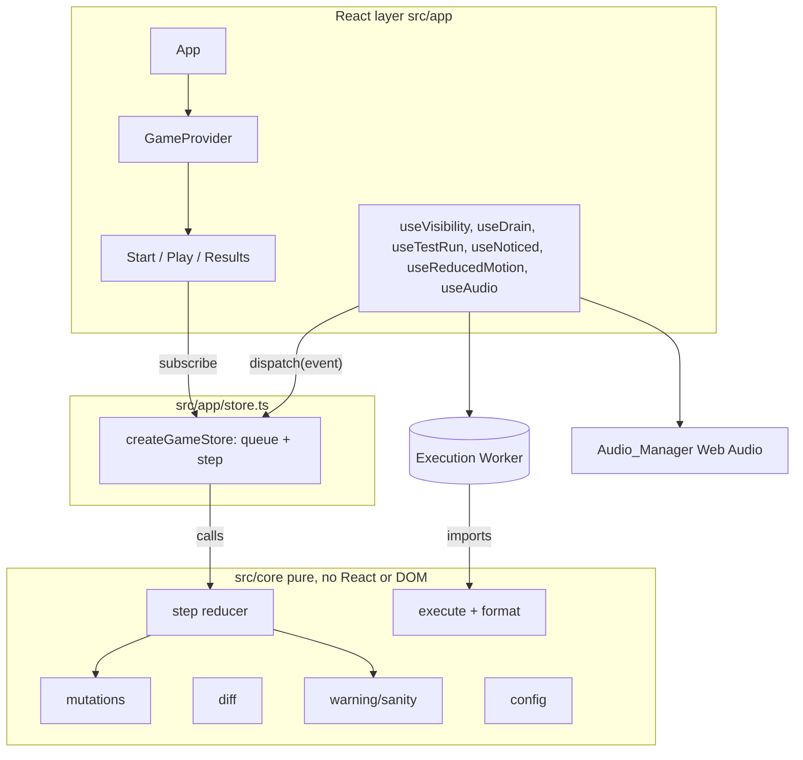
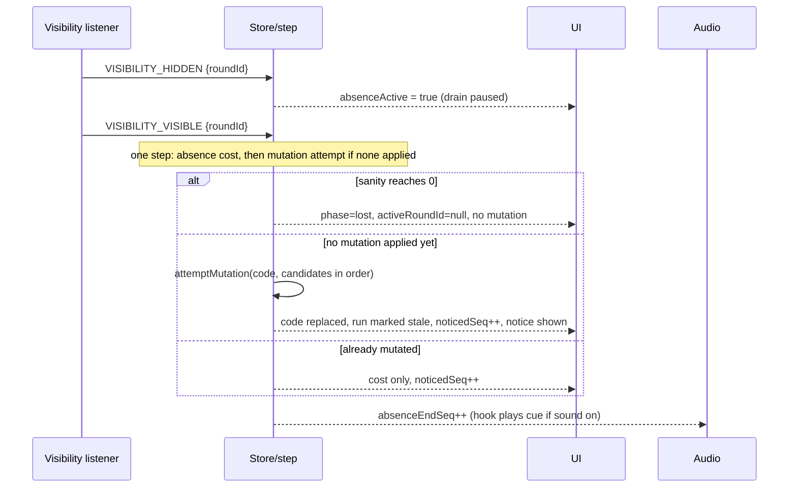
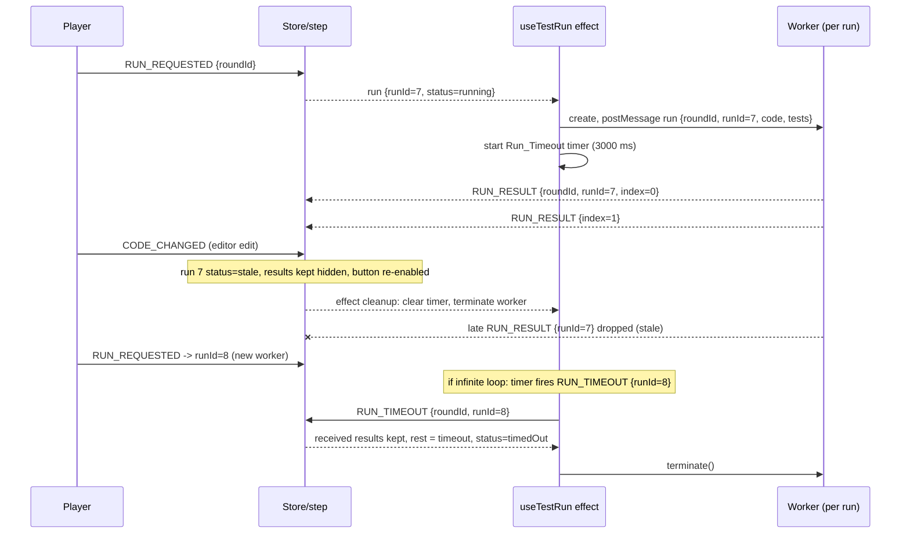
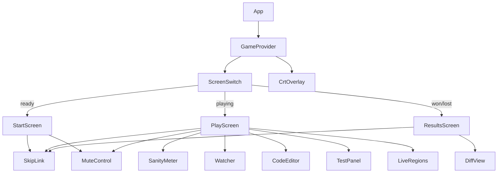

# Design Document

## Overview

"Don't Look Away" is a single-page React + TypeScript (strict) + Vite game. The player fixes one JavaScript function (`brightestCandle`) while sanity drains. Switching away from the tab (Page Visibility API only) costs sanity, and the first return in a round lets the Watcher apply one curated, deterministic Mutation. The Results screen reveals the change as a line diff.

Design goals:

1. **Pure, testable core.** All rules (state machine, ordering, stale handling, sanity, warning levels, mutations, diff, config) live in `src/core` with no React or DOM imports.
2. **One ordered event pipeline.** A tiny external store runs a pure reducer synchronously, one event at a time. Round invalidation therefore happens in the same step as the transition (Req 1.4, 15.11).
3. **Off-thread execution.** Player code runs in a short-lived Web Worker per run. Results stream one message per test. A main-thread timer enforces `Run_Timeout`.
4. **Everything tunable in one place.** `Game_Config` holds every playtest setting (Req 21.11).
5. **Restrained horror.** Dark charcoal, one red accent, subtle CRT, dread that escalates by Warning_Level.

Key decisions:

| Decision | Choice | Why |
|---|---|---|
| State | Pure reducer `step(state, event, config, deps)` wrapped by a synchronous store read through `useSyncExternalStore` | Strict event order and immediate token invalidation do not depend on React batching |
| Editor | CodeMirror 6 | Small, accessible, themeable, scriptable (see Editor Library) |
| Execution | `new Function` inside a per-run module Worker | Main-thread responsiveness; `terminate()` is the only stop for infinite loops |
| Diff | Own line-LCS in core | No dependency, easy round-trip property |
| PBT | fast-check on Vitest | Standard for TS |

Research notes: CodeMirror 6 packages checked on npm at design time (`codemirror` 6.0.2, `@codemirror/view` 6.43.x, `@codemirror/state` 6.7.x, `@codemirror/commands` 6.11.x, `@codemirror/lang-javascript` 6.2.x). Other tools (Vite, Vitest, fast-check 4.x, React 19, React Testing Library 16, jsdom) also resolved on npm. The implementation should install the latest compatible releases and commit the lockfile rather than trust these numbers. Bundle-size figures below are estimates, not measurements.

## Architecture



Layering rules (enforced by a static import-scan test, Req 22.1):

- `src/core/**` imports nothing from `react`, `react-dom`, `src/app`, `src/audio`, and references no `window`, `document`, `navigator`, or web storage APIs. It may use `Function`, `JSON`, and standard globals. The Worker script imports from core.
- `src/app/**` may use DOM and React. It never evaluates player code.
- Nothing under `src/` imports from `tests/`. The Reference_Solution lives in `tests/fixtures/` and is therefore never bundled (Req 3.3).

### Event pipeline and ordering

`createGameStore(config, deps)` holds `state` and a FIFO queue. `dispatch(event)` pushes onto the queue and, unless already draining, loops `state = step(state, event).state` until the queue is empty, then notifies subscribers once. A dispatch made by a subscriber during draining is queued, never re-entrant. Timers and listeners capture the `roundId` (and `runId` for the run timeout) when they are registered and dispatch events carrying them. Worker messages are different: the dispatched event carries the message's OWN `roundId` and `runId`, never captured values (Req 5.9). The reducer drops any event whose tokens do not match.

`GameState.activeRoundId` is `number | null`. It is set when a round starts and set to `null` in the same `step` call that moves the state to `won`, `lost`, or `ready`. The store exposes `getActiveRoundId()` so hooks may also pre-check before dispatching, but the reducer check is authoritative.

Ordered-event rule (Req 1.5 to 1.7): `DRAIN_TICK` and `ABSENCE_END` that bring sanity to 0 end the round in the same step (`lost`). A later `RUN_RESULT` completing an all-pass run then finds `phase !== 'playing'` and is discarded. If the all-pass run completes first while sanity is still above 0, the outcome is `won`. If sanity is already 0 when a complete all-pass run is processed, which can only happen if the sanity event was processed in the same step, the reducer yields `lost` (defensive check kept for Req 1.6).



Decision: when the absence cost brings sanity to 0, the round is lost and no Mutation is attempted. This keeps Req 1.7 and 11.8 simple (a lost round never changes code afterward). Mutation attempts happen only when sanity stays above 0.

### Stale-result and run handling



Rules inside `step`:

- `RUN_REQUESTED` is accepted only when `phase==='playing'` and no run has status `running`. It assigns `runId = nextRunId++`, stores `run = {runId, roundId, status:'running', results: []}`.
- `CODE_CHANGED` and a successful Mutation set a running run to `stale` in the same step. A stale run is invalidated at once; later messages, timers, and results for it are no-ops (Req 7.1, 7.2, 7.7). The displayed results of the last complete or timed-out run remain, flagged `outdated` (Req 7.5). A stale run never auto-restarts (Req 7.8).
- `RUN_RESULT` is applied only when its own `roundId` equals `activeRoundId`, its own `runId` equals the latest run's `runId`, `status==='running'`, `Number.isInteger(result.index)`, `0 <= index < run.testCount`, and the index has not been received yet. Otherwise the event is `discarded` with no state change (Req 5.9, 5.14). Accepted results are stored by index.
- `RUN_DONE` (the worker's run-complete message) with matching own tokens and `count === testCount` marks `doneReceived`. If some indices are still missing at that point, they are filled with `error` ("worker finished early"), which makes an all-pass win impossible.
- A run becomes `complete` only when every index `0..testCount-1` has been received exactly once AND `doneReceived` is true. Win evaluation happens in the step that completes the run, and only if every result is `pass` (Req 5.4, 5.13). A run with all results but no `done` message stays `running` until `done` arrives, the timeout fires (then `timedOut`, no win), or the run is staled. Partial runs never evaluate the win.
- `RUN_TIMEOUT` keeps received results, fills missing ones with `timeout`, sets `status='timedOut'`, and evaluates no win.
- `RUN_ABORT` (sent only by the provider's `detach()`, see Cleanup) marks a running run `stale`; it never changes phase or sanity.
- `RUN_FAILED` (worker creation failure or worker `error` event) fills missing results with `error`, sets `status='failed'`, and sets `runError`.
- A new run's first result replaces the previously displayed results in the same step (Req 6.7), because `state.displayRun` switches to the new run when its first result arrives. Until then the old results show as outdated.

## Components and Interfaces

### Project structure

```
.
├── .kiro/specs/dont-look-away/{requirements.md,design.md}
├── docs/EXECUTION.md
├── index.html                  (lang="en")
├── package.json  tsconfig.json  vite.config.ts  vitest.config.ts
├── scripts/verify-build.mjs     (build verification: real worker in `vite preview`)
├── src/
│   ├── main.tsx                (StrictMode root)
│   ├── core/                   (pure; no React/DOM)
│   │   ├── types.ts            GameState, Round, SanityState, TestResult, MutationRecord, events
│   │   ├── config.ts           GameConfig, DEFAULT_CONFIG, normalizeConfig, parseConfigOverrides
│   │   ├── reducer.ts          step()
│   │   ├── sanity.ts           applyDrain, applyAbsenceCost, warningLevelFor
│   │   ├── challenge.ts        CHALLENGE (description, starter, tests)
│   │   ├── mutations.ts        CANDIDATES, attemptMutation
│   │   ├── diff.ts             diffLines, newFromDiff, oldFromDiff
│   │   ├── execute.ts          runTestCases(code, fnName, tests) -> TestResultPayload[] (shared with worker)
│   │   ├── format.ts           truncateForDisplay, serializeValue, deepEqual
│   │   ├── protocol.ts         worker message types + guards
│   │   └── registry.ts         createRegistry(): idempotent cleanup bookkeeping
│   ├── worker/
│   │   ├── execution.worker.ts        the worker script
│   │   └── createExecutionWorker.ts   the ONLY file with `new Worker(new URL('./execution.worker.ts', import.meta.url), ...)`; same directory as the script
│   ├── app/
│   │   ├── store.ts            createGameStore
│   │   ├── GameProvider.tsx    context, store creation, dev config overrides
│   │   ├── hooks/              useVisibility, useDrain, useTestRun, useNoticed, useReducedMotion, useAudio
│   │   ├── resources.ts        DOM helpers built on core/registry
│   │   └── screens/            StartScreen, PlayScreen, ResultsScreen
│   ├── components/             CodeEditor, TestPanel, SanityMeter, Watcher, CrtOverlay, MuteControl, SkipLink, DiffView, LiveRegions
│   ├── audio/audioManager.ts   Web Audio synthesis
│   └── styles/{tokens.css,app.css}
└── tests/
    ├── fixtures/referenceSolution.ts   (test-only)
    ├── core/*.test.ts   core/*.property.test.ts
    ├── worker/*.test.ts  fixtures/*.test.ts  components/*.test.tsx  (incl. strictMode.test.tsx)
    └── boundaries.test.ts              (import-scan)
```

### React component tree



`ScreenSwitch` renders exactly one screen from `state.phase`, so the change is one commit (Req 1.11, 2.9).

| Unit | Responsibility |
|---|---|
| `GameProvider` | Creates the store once per mount with a lazy `useState` initializer. Its only effect calls `store.detach()` in cleanup; `detach()` never disposes the store (see Cleanup and Resource Management). Builds config (defaults plus dev overrides), provides `{state, dispatch, config, reducedMotion}` |
| `StartScreen` | Title, instructions (Req 2.2 to 2.7, 16.8), start button (disabled plus error if content missing, Req 2.10), focus to start on mount |
| `PlayScreen` | Layout, challenge text, mounts Watcher, editor, panel, meter, live regions; focuses its `h1` on mount |
| `ResultsScreen` | Outcome, final sanity, mutation count, diff or "The Watcher changed nothing.", restart; focuses `h1` on mount |
| `useVisibility` | Registers `visibilitychange` while playing; dispatches `VISIBILITY_HIDDEN/VISIBLE` tagged with `roundId` |
| `useDrain` | While playing and `!absenceActive`, registers an interval of `drainIntervalMs` dispatching `DRAIN_TICK` |
| `useTestRun` | Effect keyed by `[roundId, run.runId, run.status==='running']`: creates the worker, posts the run, starts the timeout timer; cleanup clears the timer and terminates the worker |
| `useNoticed` | Effect keyed by `noticedSeq`: sets a `noticedDurationMs` timer dispatching `NOTICED_EXPIRED {roundId, seq}`; a later seq supersedes (Req 10.5) |
| `useReducedMotion` | `matchMedia('(prefers-reduced-motion: reduce)')` with a `change` listener; returns `true` if `matchMedia` is unavailable or throws (Req 17.4 to 17.6) |
| `useAudio` | Subscribes to `absenceEndSeq`, `warningLevel`, `soundOn`; drives `AudioManager` |

### Core interfaces (TypeScript)

```ts
export type Phase = 'ready' | 'playing' | 'won' | 'lost';
export type WarningLevel = 'calm' | 'uneasy' | 'distressed' | 'critical';
export type TestStatus = 'pass' | 'fail' | 'error' | 'timeout';

export interface SanityState { value: number }          // integer 0..100

export interface TestResult {
  index: number;               // Test_Case index
  status: TestStatus;
  message: string;
  expectedText: string;        // already truncated (<=500 + indicator)
  actualText: string | null;   // null for error/timeout
}

export type RunStatus = 'running' | 'complete' | 'timedOut' | 'failed' | 'stale';
export interface Run {
  runId: number; roundId: number; status: RunStatus;
  testCount: number;           // Challenge test count, fixed when the run is created
  results: TestResult[];       // sorted by index, exactly one per accepted index
  doneReceived: boolean;       // run-complete message accepted
  error?: string;              // worker creation/worker-level failure text
}

export interface MutationRecord {
  id: string; description: string;
  snapshot: string;            // Code_Snapshot taken before the Mutation
  resultingCode: string;
}
export type SkipReason = 'target-missing' | 'transform-failed' | 'no-change' | 'size-limit';
export interface SkippedRecord { id: string; reason: SkipReason }

export interface Round {
  roundId: number;
  absenceActive: boolean;
  applied: MutationRecord | null;          // 0 or 1
  lastAttemptSkipped: SkippedRecord[];     // per latest attempt
  noticedSeq: number;                      // bumps on every Absence end
  absenceEndSeq: number;                   // audio cue trigger
  noticedActive: boolean;
}

export interface GameState {
  phase: Phase;
  activeRoundId: number | null;            // null whenever phase != 'playing'
  nextRoundId: number;
  nextRunId: number;                       // monotonic for the session
  sanity: SanityState;
  code: string;
  round: Round | null;                     // retained in won/lost for the results reveal
  run: Run | null;                         // latest run
  displayRun: Run | null;                  // last run whose results are shown
  resultsOutdated: boolean;
  notice: 'none' | 'watcherChanged';
}

export type GameEvent =
  | { type: 'START' }
  | { type: 'RESTART' }
  | { type: 'CODE_CHANGED'; roundId: number; code: string }
  | { type: 'DRAIN_TICK'; roundId: number }
  | { type: 'VISIBILITY_HIDDEN'; roundId: number }
  | { type: 'VISIBILITY_VISIBLE'; roundId: number }
  | { type: 'NOTICED_EXPIRED'; roundId: number; seq: number }
  | { type: 'RUN_REQUESTED'; roundId: number }
  | { type: 'RUN_RESULT'; roundId: number; runId: number; result: TestResult }
  | { type: 'RUN_DONE'; roundId: number; runId: number; count: number }
  | { type: 'RUN_ABORT'; roundId: number; runId: number }
  | { type: 'RUN_TIMEOUT'; roundId: number; runId: number }
  | { type: 'RUN_FAILED'; roundId: number; runId: number; message: string };

export type StepOutcome = 'applied' | 'discarded' | 'rejected';
export interface StepResult { state: GameState; outcome: StepOutcome }
export interface CoreDeps { saveSnapshot?: (code: string) => boolean }   // fault injection for Req 13.2

export function step(s: GameState, e: GameEvent, cfg: GameConfig, deps?: CoreDeps): StepResult;
```

`outcome` semantics: `rejected` for a transition not permitted by Req 1 (Req 22.9: state unchanged and the caller is told), `discarded` for tagged events that no longer match (stale, wrong round, wrong phase), `applied` otherwise. `START` is allowed only from `ready`; `RESTART` only from `won`/`lost`. A second `RESTART` is `rejected` because the phase is already `ready` (Req 14.8).

`RESTART` returns `initialState(config)` except `nextRoundId` and `nextRunId`, which carry forward so ids stay unique within the page lifetime. The sound preference is not in `GameState`; it lives in the audio provider and is untouched (Req 14.6, 19.8).

### Sanity and warning levels

```ts
export function warningLevelFor(value: number, cfg: GameConfig): WarningLevel | null;
// null for non-integers, NaN, <0, >100 (caller keeps the previous level, Req 9.9)
export const severity: Record<WarningLevel, number> = { calm: 0, uneasy: 1, distressed: 2, critical: 3 };
```

Thresholds come from `cfg.thresholds = {calmMin: 71, uneasyMin: 41, distressedMin: 21}`. `critical` covers everything below `distressedMin`, so 0 is critical.

Sanity changes only in `DRAIN_TICK` (`-drainAmount`), `VISIBILITY_VISIBLE` ending an absence (`-absenceCost`), and `START` (reset to 100). Both subtractions floor at 0. `DRAIN_TICK` is a no-op while `absenceActive`. All run events leave sanity untouched.

### Mutation engine

```ts
export interface CandidateMutation {
  id: string;                 // 1..64 chars
  description: string;        // 1..200 chars; shown on Results only
  target: string;             // exact substring
  transform: (code: string) => string;   // pure
}
export type AttemptResult =
  | { kind: 'applied'; record: MutationRecord; skipped: SkippedRecord[] }
  | { kind: 'none'; skipped: SkippedRecord[] }              // all skipped
  | { kind: 'cancelled'; skipped: SkippedRecord[] };        // snapshot store failed

export function attemptMutation(
  code: string, candidates: readonly CandidateMutation[], save: (s: string) => boolean, maxLength: number
): AttemptResult;
export const replaceFirst = (target: string, replacement: string) =>
  (code: string) => { const i = code.indexOf(target); return i < 0 ? code : code.slice(0, i) + replacement + code.slice(i + target.length); };
```

Per-candidate flow, in `cfg.candidateOrder`:

1. `target` not in code: skip, reason `target-missing`.
2. `transform` throws: skip, reason `transform-failed`.
3. Output equals input: skip, reason `no-change`.
4. Output length greater than `maxLength` (`cfg.editorMaxLength`): skip, reason `size-limit`. No snapshot is stored for this candidate (Req 12.17).
5. Otherwise save the Code_Snapshot, then apply. If `save` returns false or throws, the whole attempt is `cancelled` (below).

The skip reasons are exactly `target-missing`, `transform-failed`, `no-change`, and `size-limit`; a snapshot failure is not a skip reason, it cancels the attempt. The first success stops the attempt. If `save` returns false or throws, the attempt is `cancelled`: no later candidate is tried, nothing is recorded as applied, and a later Absence retries (Req 12.16, 13.2). No randomness anywhere. The reducer calls `attemptMutation` only when `round.applied === null`.

### Diff

```ts
export type DiffLine = { kind: 'same' | 'add' | 'remove'; text: string };
export function diffLines(oldText: string, newText: string): DiffLine[];
export const newFromDiff = (d: DiffLine[]) => d.filter(l => l.kind !== 'remove').map(l => l.text).join('\n');
export const oldFromDiff = (d: DiffLine[]) => d.filter(l => l.kind !== 'add').map(l => l.text).join('\n');
```

Split on `'\n'`, strip the common prefix and suffix, then run a line LCS on the middle. If `n*m > 4_000_000`, fall back to "remove all, add all" for the middle so worst-case cost is bounded; the round-trip stays exact. `DiffView` renders `-`/`+`/two-space markers as text (Req 13.6) plus color.

### Test execution (core, shared by worker and fixture tests)

```ts
export interface TestCaseDef { name: string; args: unknown[]; expected: unknown }
export function runTestCases(code: string, fnName: string, tests: readonly TestCaseDef[],
                             onResult: (r: TestResult) => void): void;
```

Behavior:

1. Compile once: `new Function('"use strict";\n' + code + '\n;return typeof ' + fnName + " === 'function' ? " + fnName + ' : undefined;')()`. `fnName` is a validated identifier from the Challenge (never player-supplied). A thrown `SyntaxError` (or any compile error) calls `onResult` with `error` and the message for every test (Req 5.5). If the result is not a function, every test is `error` ("Function `brightestCandle` is not defined").
2. For each test, in order: `try { actual = fn(...structuredCloneSafeArgs) }` where args are deep-cloned per test (`structuredClone`) so one test cannot corrupt another's inputs. Compare with `deepEqual(actual, expected)`. `pass` or `fail`. A thrown value gives `error` with `String(e)`, then the loop continues.
3. `actualText = truncateForDisplay(serializeValue(actual), 500)`, `expectedText` likewise. `serializeValue` uses `JSON.stringify` with a replacer for `undefined`, `NaN`, `Infinity`, `bigint`, and functions, a cycle guard, and falls back to `String(value)` inside `try/catch`. The result is always a string, so the message is structured-clone-safe (Req 5.8).
4. `truncateForDisplay(text, max)` returns `text` unchanged when `text.length <= max`; otherwise `text.slice(0, max) + '… [truncated]'`.
5. One `onResult` call per test, with `index` equal to the test's zero-based position; the worker posts each immediately (streaming).

A synchronous infinite loop in player code cannot be interrupted from inside the worker. It is stopped only by `worker.terminate()` from the main thread timer. There is no security sandbox (Req 16).

### Worker message protocol

```ts
// src/core/protocol.ts
export interface TestCasePayload { name: string; args: unknown[]; expected: unknown }

export type MainToWorker =
  | { type: 'run'; roundId: number; runId: number; code: string; fnName: string; tests: TestCasePayload[] };

export type WorkerToMain =
  | { type: 'result'; roundId: number; runId: number; result: TestResult }
  | { type: 'done';   roundId: number; runId: number; count: number }
  | { type: 'fatal';  roundId: number; runId: number; message: string };
```

All variants carry `roundId` and `runId` (Req 5.8). Guards `isWorkerToMain(x)` validate shape (including a known `status` and `Number.isInteger(result.index)`); malformed messages are dropped. The guard does not check ids against the current run; the reducer does, using the message's own ids.

Worker (`src/worker/execution.worker.ts`):

```ts
self.onmessage = (ev: MessageEvent<MainToWorker>) => {
  const m = ev.data;
  if (m?.type !== 'run') return;
  try {
    runTestCases(m.code, m.fnName, m.tests, r =>
      self.postMessage({ type: 'result', roundId: m.roundId, runId: m.runId, result: r }));
    self.postMessage({ type: 'done', roundId: m.roundId, runId: m.runId, count: m.tests.length });
  } catch (e) {
    self.postMessage({ type: 'fatal', roundId: m.roundId, runId: m.runId, message: String(e) });
  }
};
```

Main thread (`useTestRun`) creates the worker through an injectable `WorkerFactory`. The default factory lives in `src/worker/createExecutionWorker.ts`, in the same directory as `execution.worker.ts`, so the URL is relative to the file that contains it:

```ts
export interface WorkerLike {
  postMessage(m: MainToWorker): void; terminate(): void;
  onmessage: ((e: MessageEvent) => void) | null;
  onerror: ((e: ErrorEvent) => void) | null;
  onmessageerror: ((e: MessageEvent) => void) | null;
}
export type WorkerFactory = () => WorkerLike;
// src/worker/createExecutionWorker.ts  (sibling of execution.worker.ts)
export const defaultWorkerFactory: WorkerFactory = () =>
  new Worker(new URL('./execution.worker.ts', import.meta.url), { type: 'module' }) as unknown as WorkerLike;
```

Vite resolves `new URL('./execution.worker.ts', import.meta.url)` relative to the file that contains the expression, and statically detects the exact `new Worker(new URL(<literal>, import.meta.url), ...)` form to emit the worker as a separate built asset. Keeping the constructor and the script in one directory makes the string and the layout consistent; the constructor appears in no other file. `vite.config.ts` sets `worker: { format: 'es' }` to match `type: 'module'` (Req 5.15, 21.12). The build-verification step in the Testing Strategy covers both the dev server and the production build.

Lifecycle per run (inside one effect so that cleanup is the single termination path):

1. Effect starts when `run.status === 'running'`. It registers a `Run_Timeout` timer (`cfg.runTimeoutMs`) and creates the worker through the registry, so the cleanup callback terminates the worker and clears the timer.
2. `onmessage` validates shape with `isWorkerToMain` and dispatches `RUN_RESULT`, `RUN_DONE`, or `RUN_FAILED` carrying the message's OWN `roundId` and `runId`. The effect never substitutes its captured ids for the received ones; the reducer compares them with the active round and the current run, and discards mismatches, out-of-range or non-integer indices, and duplicates (Req 5.9, 5.14). The captured ids are used only for the timeout timer event.
3. Factory throws, `onerror`, `onmessageerror` (these carry no message ids, so the effect's captured ids are used and the reducer still checks them), or a `fatal` message (own ids) dispatch `RUN_FAILED` (Req 5.10). The panel shows "Tests could not run." and the button is re-enabled because `run.status` is no longer `running`.
4. When the run leaves `running` for any reason (complete, timedOut, failed, stale) or the round ends, React runs the effect cleanup: the timer is cleared, the worker is terminated, and the idle worker count returns to 0 (Req 5.12, 15.2, 15.12). The timer callback also checks a local `disposed` flag so it fires at most once (Req 15.4).
5. A late message from a terminated worker may still reach the main thread. `onmessage` is set to `null` during cleanup, and the reducer discards anything that gets through.

### Editor Library

Options evaluated against the requirements:

| Criterion | CodeMirror 6 | Monaco | react-simple-code-editor + Prism | Textarea overlay (own) |
|---|---|---|---|---|
| Bundle (est.) | About 100 to 150 KB gzipped with JS language | Multiple MB plus workers | About 20 KB | Smallest |
| Accessibility | Real contenteditable, screen reader support, built-in keyboard model | Good, but heavy and has its own tab handling | Textarea is accessible, but the highlighted layer duplicates text | Same as left |
| Escape releases Tab | Via a keymap compartment (below) | Built-in toggle (Ctrl+M), non-standard | Must write | Must write |
| Programmatic replace | `view.dispatch({changes})`, preserves undo | `setValue`/edits | Controlled prop, resets caret | Resets caret |
| Read-only | `EditorState.readOnly` keeps focus and scroll | `readOnly` option | `disabled` removes from tab order | `readOnly` |
| 100,000-char cap | `EditorState.changeFilter`/`transactionFilter` rejects whole transaction (incl. paste) | `onChange` revert, flickers | Revert after the fact | Revert after the fact |
| Theming | `EditorView.theme` plus `HighlightStyle` using CSS variables | Theme API, heavy | Prism CSS | CSS |
| jsdom/Vitest | State layer works without DOM; view needs light polyfills | Not realistic in jsdom | Easy | Easy |

**Recommendation: CodeMirror 6** (`@codemirror/state`, `@codemirror/view`, `@codemirror/commands`, `@codemirror/lang-javascript`, `@codemirror/language`; we do not use the `codemirror` meta package and `basicSetup`, so only needed extensions ship). It meets the 100,000-char filter and read-only requirements natively, supports atomic programmatic replacement, themes from our CSS tokens, and its keymap model makes the Escape/Tab behavior small. Risk: view-level tests under jsdom need `Range.prototype.getClientRects/getBoundingClientRect` stubs. Mitigation: test configuration (filters, keymaps, read-only) at the `EditorState` level and keep view-level tests to mount, aria, and focus.

Extensions in `CodeEditor.tsx`:

```ts
const tabKeys = new Compartment();    // Tab trap on/off
const readOnly = new Compartment();   // terminal states
const filterExt = EditorState.transactionFilter.of(tr => {
  if (tr.docChanged && tr.newDoc.length > cfg.editorMaxLength) { onLimit(); return []; }   // reject whole transaction
  return tr;
});
const extensions = [
  history(), javascript(), syntaxHighlighting(darkHighlight), darkTheme, filterExt,
  keymap.of([
    { key: 'Mod-Enter', run: () => { onRun(); return true; } },   // ignored by reducer if a run is active
    { key: 'Escape', run: (v) => { v.dispatch({ effects: tabKeys.reconfigure([]) }); return true; } },
    ...historyKeymap, ...defaultKeymap,
  ]),
  tabKeys.of(keymap.of([indentWithTab])),                        // trap armed by default
  readOnly.of(EditorState.readOnly.of(false)),
  EditorView.contentAttributes.of({ 'aria-label': 'Code editor', 'aria-multiline': 'true' }),
  EditorView.domEventHandlers({ blur: (_e, v) => { v.dispatch({ effects: tabKeys.reconfigure(keymap.of([indentWithTab])) }); } }),
  EditorView.updateListener.of(u => { if (u.docChanged && !u.transactions.some(t => t.annotation(External))) onUserChange(u.state.doc.toString()); }),
];
```

- **Escape/Tab:** while the compartment holds `indentWithTab`, Tab and Shift+Tab indent (Req 4.7). Escape swaps the compartment to an empty keymap, so Tab is not handled by the editor and the browser moves focus to the next focusable element (Req 4.5, 18.6). The trap re-arms on blur so a later visit to the editor starts armed. A short hint ("Esc then Tab leaves the editor") is rendered next to the editor.
- **Limit (Req 4.8):** the transaction filter drops the whole transaction when the resulting document would exceed `editorMaxLength`, keeping previously accepted code, and calls `onLimit` to show the "limit reached" indication (a status line, `role="status"`).
- **Programmatic replace (Req 12.10):** `GameState.code` is the source of truth. An effect compares `state.code` with `view.state.doc.toString()` and, when they differ, dispatches `{ changes: { from: 0, to: len, insert: state.code }, annotations: External.of(true) }`. The `External` annotation stops the update listener from echoing it back as a user `CODE_CHANGED`. The same dispatch bypasses the length filter because Mutation output is at most slightly longer than the input and the pre-mutation code is within the limit; if it would exceed the limit the candidate is skipped in core with reason `size-limit` (`attemptMutation` receives `maxLength` from the reducer).
- **Read-only (Req 4.3):** when the phase is `won`/`lost`, an effect reconfigures `readOnly` to `EditorState.readOnly.of(true)`. The editor stays focusable, readable, and scrollable.
- **Theme:** `EditorView.theme({...}, {dark: true})` and `HighlightStyle` read CSS variables from `tokens.css`. Syntax colors are neutral grays and one desaturated tint; red is not used for syntax so the single red accent stays meaningful.

## Data Models

### Game_Config

All gameplay values live in `src/core/config.ts` and are read only through a `GameConfig` object passed to core functions and hooks (Req 21.11).

```ts
export interface GameConfig {
  drainIntervalMs: number;     // 2000
  drainAmount: number;         // 1
  absenceCost: number;         // 10
  thresholds: { calmMin: number; uneasyMin: number; distressedMin: number }; // 71, 41, 21
  runTimeoutMs: number;        // 3000
  editorMaxLength: number;     // 100_000
  noticedDurationMs: number;   // 3000
  volumeCap: number;           // 0.5 (clamped to 0..0.5)
  testCountMin: number;        // 4
  testCountMax: number;        // 8
  candidateOrder: readonly string[];  // ['off-by-one','flipped-comparison','lost-name']
}
export const DEFAULT_CONFIG: GameConfig = { /* defaults above */ };
export function normalizeConfig(partial: Partial<GameConfig>): GameConfig;       // merge + clamp, never throws
export function parseConfigOverrides(search: string, base: GameConfig): GameConfig; // pure
```

Clamping ranges: `drainIntervalMs` 100 to 60,000; `drainAmount` 0 to 100; `absenceCost` 0 to 100; thresholds integers with `0 < distressedMin < uneasyMin < calmMin <= 100` (otherwise the default thresholds are used as a group); `runTimeoutMs` 200 to 30,000; `editorMaxLength` 1,000 to 1,000,000; `noticedDurationMs` 200 to 30,000; `volumeCap` 0 to 0.5; `testCountMin <= testCountMax` within 1 to 20; `candidateOrder` must be a permutation of the defined candidate ids, otherwise the default order is used.

Overrides by URL query (playtest only): enabled when `import.meta.env.DEV || import.meta.env.VITE_PLAYTEST === '1'`; the composition root calls `parseConfigOverrides(location.search, DEFAULT_CONFIG)` only then, so production builds ignore the query. Keys: `drainMs`, `drainAmount`, `absenceCost`, `runTimeoutMs`, `noticedMs`, `editorMax`, `volume`, `order` (comma list). Unknown keys and unparsable values are ignored; every value passes through `normalizeConfig`. The core never reads `location`.

Tests pass custom configs directly: `step(state, event, normalizeConfig({ absenceCost: 50, runTimeoutMs: 200 }))`, `createGameStore(cfg)`, or `<GameProvider config={cfg}>`.

### The Challenge: `brightestCandle`

Description (under 500 chars): "The candles remember who burned brightest. Return the index of the brightest candle in the list. If two candles burn equally bright, the first one wins. If there are no candles, return -1."

Function name: `brightestCandle`.

Starter code (shown to the player; passes tests 0 to 3, fails test 4 because `>=` lets the last tie win):

```js
// The candles remember who burned brightest.
// Return the index of the brightest candle. Ties go to the first one.
// No candles? Return -1.
function brightestCandle(candles) {
  let best = -1;
  for (let i = 0; i < candles.length; i++) {
    if (best === -1 || candles[i] >= candles[best]) {
      best = i;
    }
  }
  return best;
}
```

Test cases (5, within 4 to 8; unique names):

| # | Name | Args | Expected |
|---|---|---|---|
| 0 | `no candles` | `[[]]` | `-1` |
| 1 | `a single flame` | `[[7]]` | `0` |
| 2 | `brightest in the middle` | `[[2, 9, 4]]` | `1` |
| 3 | `brightest at the end` | `[[2, 4, 9]]` | `2` |
| 4 | `ties go to the first candle` | `[[5, 8, 8, 3]]` | `1` |

Reference solution (test fixture `tests/fixtures/referenceSolution.ts`, never imported by `src/`; it is identical to the starter, including the three leading comment lines, except `>` instead of `>=`):

```js
// The candles remember who burned brightest.
// Return the index of the brightest candle. Ties go to the first one.
// No candles? Return -1.
function brightestCandle(candles) {
  let best = -1;
  for (let i = 0; i < candles.length; i++) {
    if (best === -1 || candles[i] > candles[best]) {
      best = i;
    }
  }
  return best;
}
```

Candidate mutations (exactly 3, in `Mutation_Sequence` order). Targets are exact substrings that occur in both the starter and the reference solution (none of them occurs in the shared leading comments), and in most natural fixes of the starter (the player usually only changes `>=` to `>`). The first occurrence is replaced.

| id | Description (Results screen only) | Target | Replacement |
|---|---|---|---|
| `off-by-one` | "The Watcher shortened the loop by one step." | `i < candles.length` | `i < candles.length - 1` |
| `flipped-comparison` | "The Watcher turned the brightest candle into the dimmest." | `candles[i] >` | `candles[i] <` |
| `lost-name` | "The Watcher renamed what you were holding onto, and left a note." | `let best = -1;` | `let beast = -1; // the light is not yours` |

Each transform is `replaceFirst(target, replacement)`. The unsettling touches are the quiet off-by-one, the inverted truth about "brightest", and a renamed variable with a note. The `lost-name` change is a code-behavior change (the references to `best` now throw `ReferenceError`); the appended comment is only flavor and is never the sole change. It does not collide with the shared leading comments: the target `let best = -1;` is not in them, and the replacement adds a trailing comment on the code line instead of editing them.

Verification (re-run with Node on the exact code in this document, using the same strict-mode `new Function` approach as `runTestCases`; columns are test indices 0 to 4; P pass, F fail, E error):

| Code | 0 | 1 | 2 | 3 | 4 |
|---|---|---|---|---|---|
| Reference | P | P | P | P | P |
| Starter | P | P | P | P | F |
| Reference + `off-by-one` | P | F | P | F | P |
| Reference + `flipped-comparison` | P | P | F | F | F |
| Reference + `lost-name` | E | E | E | E | E |

Starter and reference differ in exactly one line (`>=` versus `>`); replacing `>=` in the starter yields the reference text byte for byte. Each target occurs in both starter and reference. All three mutated references compile and each fails at least one test (`off-by-one` fails 1 and 3, `flipped-comparison` fails 2, 3, 4, `lost-name` throws `ReferenceError: best is not defined` in every test). Fixture tests repeat these checks automatically, including the exact table (Req 22.14 to 22.16).

### Style tokens (`src/styles/tokens.css`)

```css
:root {
  --bg: #111214;            /* charcoal, relative luminance ~0.006 (<= 0.02) */
  --bg-raised: #17181b;
  --text: #d9d6cf;          /* contrast on --bg ~12:1 */
  --text-muted: #9a978f;    /* ~6:1 */
  --accent: #e04a43;        /* the only red; ~4.7:1 on --bg */
  --focus: #e8e6df;         /* ring, >= 3:1 against --bg and --accent */
  --focus-width: 3px;
  --font-mono: "JetBrains Mono", ui-monospace, "SF Mono", Menlo, Consolas, monospace; /* bundled woff2 falls back to system */
  --crt-scan-alpha: 0.03;   /* per-level override */
  --crt-vignette: 0;        /* per-level override */
  --watcher-opacity: 0.35;  /* per-level override */
}
```

Red intensity is expressed by opacity or `color-mix(in srgb, var(--accent) N%, transparent)` of that one token, never by a second red. Fonts are bundled `woff2` files (or system monospace); no external font host (Req 20.5, 20.6).

## Screen Layouts and Horror Experience

All screens fit at 1024x768 and up with no horizontal scroll (Req 2.1, 20.4). Every screen has `header`, one `main`, and `footer`, a single `h1`, and a skip link first in tab order.

Start screen:

```
+--------------------------------------------------------------------+
| [Skip to main content]                                  [Enable sound]|
| header: DON'T LOOK AWAY                                             |
+--------------------------------------------------------------------+
| main                                                                |
|  h1  Don't Look Away                                                |
|  Fix the function. Pass every test before your sanity reaches zero. |
|  - The game notices when this page becomes hidden (Page Visibility  |
|    API), e.g. switching tabs or minimizing. Coming back may let the |
|    Watcher change your code, at most once per round. Each later     |
|    absence still costs sanity.                                      |
|  - No camera, microphone, or eye tracking. Another visible window   |
|    may not be detected.                                             |
|  - Sound is off until you press "Enable sound" (also after reload). |
|  - Not a secure code runner: run only code you type yourself.       |
|                                                                     |
|                 [ Begin ]   <- focused on load                      |
+--------------------------------------------------------------------+
| footer: Tab-switch detection only. Nothing leaves your browser.     |
+--------------------------------------------------------------------+
```

Play screen (grid columns: challenge/tests, editor, Watcher rail; the Watcher cell never overlaps another cell):

```
+--------------------------------------------------------------------+
| [Skip to code editor]                                               |
| header:  SANITY [#########-----] 72  (role=meter)     [Mute sound]  |
+---------------------------+---------------------------+------------+
| main                      |                           |  Watcher   |
| h1 Repair brightestCandle |  Code editor (CodeMirror) |   (  o  )  |
| Challenge description     |  function brightestCandle |  aria-hidden|
|                           |  ...                      |            |
| Tests                     |  Esc, then Tab leaves the |            |
|  1 no candles   not run   |  editor  | 0 / 100000     |            |
|  2 a single ... not run   |  [ Run tests ]  (Ctrl/Cmd+Enter)       |
|  ...                      |  results outdated? badge  |            |
+---------------------------+---------------------------+------------+
| footer: [status: warning text]  [status: Watcher changed your code] |
+--------------------------------------------------------------------+
```

Results screen:

```
+--------------------------------------------------------------------+
| [Skip to main content]                                              |
| header: DON'T LOOK AWAY                                             |
+--------------------------------------------------------------------+
| main                                                                |
|  h1  You passed.   |  You lost.        (focused on render)          |
|  Final sanity: 34     Mutations applied: 1                          |
|  What the Watcher changed: "<description>"                          |
|    1   function brightestCandle(candles) {                          |
|    2     let best = -1;                                             |
|  - 3     for (let i = 0; i < candles.length; i++) {                 |
|  + 3     for (let i = 0; i < candles.length - 1; i++) {             |
|    ...                                                              |
|  (or: "The Watcher changed nothing.")                               |
|                      [ Look again ]  (restart)                      |
+--------------------------------------------------------------------+
```

### Pacing of dread by Warning_Level

| Level | Sanity | Watcher | CRT | Text warning / other | Audio (if enabled) |
|---|---|---|---|---|---|
| `calm` | 71 to 100 | Opacity 0.35, slow idle gaze, eyes half-lidded | Scanline alpha 0.03, no vignette | None | Low drone only |
| `uneasy` | 41 to 70 | Opacity 0.5, gaze fixed on the editor more often | 0.05, faint flicker | Meter fill turns red | Drone gains slight beating |
| `distressed` | 21 to 40 | Opacity 0.75, pupils dilate | 0.07, flicker slightly stronger | Text warning "It is watching your hands." at 1rem | Drone deepens |
| `critical` | 0 to 20 | Opacity 1.0, wide eyes, unblinking | 0.08, red vignette | Larger text warning "Do not look away." at 1.5rem | Tension loop |

Intensities increase monotonically so Req 9.3 to 9.5 hold. The warning text is shown on the Play screen and announced once through a polite live region per level change.

### The Watcher

An inline SVG (no network requests, Req 10.8), `aria-hidden="true"`, `focusable="false"`, in its own grid cell. Default appearance: a tall charcoal head silhouette, two pale ovals for eyes (pupil offset toward the editor), outlined in muted red at the current `--watcher-opacity`. Gaze animation is a CSS keyframe on the pupil `transform` with a cycle of 6 s (within 4 to 10 s).

"Noticed" state (class `watcher--noticed`, set while `round.noticedActive`): eyes snap wide open with pupils centered on the viewer, a red iris ring (the accent), and a visible open-mouth slit appears. At least three attributes differ from default (eye state, color, shape). It lasts `noticedDurationMs` from the latest Absence end and clears immediately when the phase leaves `playing`.

### CRT effects and reduced motion

`CrtOverlay` is a fixed full-viewport `div` with `aria-hidden`, `pointer-events: none`, and `z-index` above content but below no interactive element. It combines `repeating-linear-gradient` scanlines (alpha from `--crt-scan-alpha`, 0.03 to 0.08), a radial vignette, and a flicker keyframe on overlay opacity with a 6 s period (about 0.17 Hz, far under 3 flashes per second). The scanline alpha ceiling of 0.08 keeps code text above 4.5:1 with the overlay applied (verified manually, see Testing Strategy).

With `prefers-reduced-motion: reduce` (or when it cannot be determined): the flicker and gaze animations are removed (static gaze toward the editor, constant overlay opacity); shake, glitch, and flashes never run; the Watcher noticed state is a static swap. Levels remain distinguishable without motion through the text label, a different meter border style (`solid 1px`, `solid 2px`, `dashed 2px`, `double 4px`), the Watcher opacity, and the vignette at `critical`. A `matchMedia` `change` listener updates a React state value; no game state resets (Req 17.4).

## Audio

`src/audio/audioManager.ts` synthesizes everything with the Web Audio API (no assets, no external requests, Req 19.15).

- **Creation:** `AudioContext` is created only inside the "Enable sound" click handler (`enable()`), which also `resume()`s it and flips `soundOn = true` in the same action (Req 19.3). `START` never touches audio (Req 19.4). Before the first activation `audioManager.context === null` (Req 19.2).
- **Preference:** the in-memory preference lives in a provider above the screens, so `RESTART` keeps it (Req 14.6, 19.8). After a page reload the app always starts with `soundOn = false` and the label "Enable sound" (Req 19.1, 19.10). The preference is never written to `localStorage`, `sessionStorage`, cookies, or any other storage (Req 19.9). It exists only in memory, so a reload always starts with sound off.
- **Master gain:** one `GainNode` at `min(cfg.volumeCap, 0.5)`; every sound connects through it.
- **Sounds:** ambient drone (two slightly detuned sine oscillators near 55 Hz through a lowpass filter at low gain, started when `soundOn` and the phase is `playing`); Watcher cue (a 0.6 s descending sine sweep plus a short filtered noise burst), triggered when `absenceEndSeq` changes and sound is on (Req 19.12); critical tension loop (a triangle oscillator near 110 Hz with a slow gain LFO) while the level is `critical` and sound is on, silenced on leaving `critical` or muting (Req 19.13).
- **Mute:** `mute()` sets the master gain to 0 at the current time, stops and disconnects all nodes, and suspends the context in the same action (Req 19.7). A round change calls `silenceAll()` immediately; node release is also done in effect cleanup via the registry.
- **Failures:** `new AudioContext` throwing or being unavailable is caught; `soundOn` stays false, no message appears, and gameplay is unaffected (Req 19.11).
- **Control:** `MuteControl` is a `<button aria-pressed={soundOn}>` with text "Enable sound" or "Mute sound", rendered on both Start and Play screens.

## Accessibility

- **Landmarks:** each screen has one `header`, one `main`, one `footer`, and exactly one `h1`. `<html lang="en">` in `index.html` (Req 18.12, 18.13).
- **Skip link:** the first focusable element on each screen, `href="#main"`. On click it prevents default and focuses: the `h1` (`tabindex="-1"`) on Start, the Code_Editor on Play, and the `main` (`tabindex="-1"`) on Results (Req 18.8 to 18.11).
- **Focus management:** Start focuses the Begin button on mount; Results focuses its `h1` after render; Play focuses its `h1`. Focus moves in an effect keyed on `phase`. No positive `tabindex` anywhere.
- **Live regions:** three polite `role="status"` regions on Play: test summary ("3 of 5 tests passed", rendered only when a run is complete or timed out, so it announces once per run), warning-level text (changes only when the level changes), and the notice "The Watcher changed your code." with no identifier or details (Req 12.13). The editor limit message is also a polite status.
- **Meter:** `<div role="meter" aria-label="Sanity" aria-valuemin="0" aria-valuemax="100" aria-valuenow={value}>` with a visual fill of `value%` and visible integer text.
- **Test status:** text labels ("pass", "fail", "error", "timeout", "not run") plus an icon with `aria-hidden` and text alternative via the label (Req 6.4).
- **Focus ring:** `:focus-visible { outline: var(--focus-width) solid var(--focus); outline-offset: 2px }` for all controls (at least 2 px, at least 3:1).
- **Contrast:** token pairs above exceed 4.5:1 for text. The red accent is 4.7:1 on `--bg`; red is never used for small body text below that ratio.
- **Flashing:** no element flashes more than 3 times per second; the noticed state is a one-time swap.

## Cleanup and Resource Management

`core/registry.ts`:

```ts
export type Cleanup = () => void;
export interface Registry { register(release: () => void): Cleanup; activeCount(): number; disposeAll(): void }
export function createRegistry(): Registry;
```

`register` returns an idempotent cleanup (second and later calls do nothing and never throw; a throwing `release` is caught). `src/app/resources.ts` provides `addTimeout`, `addInterval`, `addListener`, `addWorker`, and `addAudioNode`, each calling `registry.register` with the appropriate release (`clearTimeout`, `removeEventListener`, `worker.terminate`, `node.disconnect`). Hooks call these inside `useEffect` and return the cleanup directly.

- **Round end/restart:** the reducer nulls `activeRoundId` in the same step, so every captured callback is already a no-op before React runs effect cleanup (Req 15.1, 15.11). Cleanup then clears timers, removes listeners, terminates the worker, and releases audio nodes.
- **StrictMode (setup, cleanup, setup) (Req 15.13):** the store is created once per provider mount by a lazy `useState` initializer. It is a plain object with no disposed state, so it stays usable after any cleanup. Cleanup of an effect only detaches what that effect attached (timer, interval, listener, worker, audio nodes), and the next setup attaches them again from current store state. Hooks derive what to attach from state (`phase`, `activeRoundId`, `run.status`, `noticedSeq`, `soundOn`), so a fresh setup always reaches the right set of resources. This is the simplest correct approach: no "dispose the store" step exists, because unsubscribing from `useSyncExternalStore` and clearing timers is enough to leave nothing running after a real unmount. The store holds no timers itself.
- **What `GameProvider` cleanup does:** it calls `store.detach()`, which is idempotent and does not change `phase`, sanity, code, or `activeRoundId`.
  - Idle `ready` state (the StrictMode development cycle, which runs right after mount): there is no round and no run, so `detach()` does nothing. The following setup finds the same store in `ready`, and Begin works.
  - In-progress `playing` round (a remount while playing, for example Fast Refresh): the round token is kept because a re-setup follows and the round can continue. `detach()` dispatches `RUN_ABORT` for a running run, which marks it `stale` and re-enables the Run Tests button, since that run's worker is terminated by its own effect cleanup and could never finish. The drain interval, visibility listener, noticed timer, and audio are re-attached by their hooks' setup. Late messages from the old worker carry the stale run's ids and are discarded.
  - A round that ends (`won`, `lost`, restart) is invalidated by the reducer in the same step, independent of any cleanup.
- **Real unmount:** every effect cleanup runs and `useSyncExternalStore` unsubscribes, so no React state update occurs after unmount (Req 15.3). A dispatch that arrives afterwards (for example a worker message already in flight) only updates the store object, notifies zero subscribers, and is discarded by the reducer if its tokens are stale.
- **Workers** exist only while `run.status === 'running'` (Req 15.12).

## Correctness Properties

*A property is a characteristic or behavior that should hold true across all valid executions of a system-essentially, a formal statement about what the system should do. Properties serve as the bridge between human-readable specifications and machine-verifiable correctness guarantees.*

Generators used by properties: `arbEvent(roundIds, runIds)` producing any `GameEvent` with tokens drawn from current, past, future, and random ids; `arbConfig` producing `normalizeConfig` outputs; `arbCode` of 0 to 10,000 characters mixing candidate targets, newlines, and arbitrary unicode.

### Property 1: Warning level is total and monotonic

*For any* integer sanity value from 0 to 100 and any valid config, `warningLevelFor` returns exactly one level, returns `critical` for every value from 0 to the `distressedMin - 1` boundary (including 0), and *for any* pair `0 <= A < B <= 100` the severity of A is greater than or equal to the severity of B. *For any* input that is not an integer in 0..100, it returns `null`.

**Validates: Requirements 9.1, 9.9, 22.2, 22.3**

### Property 2: Sanity stays bounded and changes only through allowed events

*For any* sequence of 0 to 1,000 events (including START, RESTART, drain ticks, visibility events, test run events, in any phase), sanity is an integer in 0..100 after every event, and between two consecutive states sanity differs only when the event was an applied `DRAIN_TICK` (decrease by `drainAmount`, floor 0), an applied Absence end in `playing` (decrease by `absenceCost`, floor 0, regardless of Mutation state), or `START`/`RESTART` (reset to 100). Run events never change sanity, and events processed outside `playing` leave sanity, phase, and Mutation records unchanged.

**Validates: Requirements 8.2, 8.3, 8.4, 8.5, 8.6, 8.7, 22.4, 22.5, 22.12**

### Property 3: Only permitted transitions occur

*For any* sequence of 0 to 1,000 events from the initial state, every phase change is one of `ready→playing`, `playing→won`, `playing→lost`, `won→ready`, `lost→ready`, and every event not permitted in the current phase yields outcome `rejected` or `discarded` with the state unchanged.

**Validates: Requirements 1.1, 1.3, 1.9, 1.10, 22.8, 22.9**

### Property 4: Terminal outcomes are final

*For any* state with phase `won` or `lost` and *for any* sequence of events not containing `RESTART`, the phase, sanity, displayed results, and round records are identical after the sequence, and no event is applied.

**Validates: Requirements 1.8, 1.12, 11.8, 22.10**

### Property 5: Ordered-event win and loss

*For any* playing state and *for any* complete current run (every test index received exactly once, a matching run-complete message received, every result `pass`), the step that completes it yields `lost` when sanity is 0 and `won` when sanity is above 0. *For any* event sequence in which a drain tick or Absence end brings sanity to 0 before an all-pass run completes, the final phase is `lost` and never `won`. *For any* partial run (fewer accepted results than Test_Cases, or no run-complete message), no win is evaluated.

**Validates: Requirements 1.5, 1.6, 1.7, 5.13, 22.11, 22.21**

### Property 6: Stale, foreign, and ended-round events are no-ops

*For any* state and *for any* tagged event (`CODE_CHANGED`, `DRAIN_TICK`, visibility, `NOTICED_EXPIRED`, `RUN_*`) whose own `roundId` differs from `activeRoundId`, or whose own `runId` differs from the latest run, or whose run is `stale`, `step` returns outcome `discarded` and a state deeply equal to the input. *For any* received worker message and any current ids, the runner dispatches an event whose `roundId` and `runId` equal the message's own values, never the captured ones. After any event that ends or restarts a round, `activeRoundId` is `null` in the same returned state, and every event carrying the ended id is a no-op.

**Validates: Requirements 5.9, 7.3, 7.4, 7.6, 14.9, 15.1, 15.10, 15.11, 22.13, 22.18, 22.20**

### Property 7: Code change or mutation stales a running run

*For any* playing state with a running run, a `CODE_CHANGED` or an applied Mutation sets the run to `stale` in the same step, and *for any* subsequent result messages for that run the displayed results do not change and no win is evaluated.

**Validates: Requirements 7.1, 7.2, 7.7, 12.14**

### Property 8: Timeout keeps received results and fills the rest

*For any* ordered prefix of streamed results with valid, unique indices (0 to N Test_Cases, any statuses) followed by `RUN_TIMEOUT`, the final results contain exactly one entry per Test_Case, every received result is unchanged, and every missing one has status `timeout`, in Test_Case order. A timed-out run never wins.

**Validates: Requirements 5.4, 5.6, 6.1, 22.19**

### Property 9: Mutation determinism and purity

*For any* code string of 0 to 10,000 characters and any candidate, applying the transform twice to the same input produces byte-identical output. *For any* code and round state, `attemptMutation` returns identical results across repeated calls.

**Validates: Requirements 12.7, 12.8, 12.11, 22.6**

### Property 10: At most one Mutation per round and ordered retry

*For any* sequence of 0 to 1,000 events containing any number of Absence ends in one round, at most one Mutation record exists, and each Absence end before success tries candidates in `candidateOrder`, stopping at the first that applies. *For any* attempt where every candidate is skipped, the code is unchanged, each skip carries exactly one reason from `target-missing`, `transform-failed`, `no-change`, `size-limit`, and the next Absence end retries all candidates. *For any* candidate whose output would exceed `editorMaxLength`, the reason is `size-limit` (never `no-change`), no snapshot is stored for it, and the next candidate is tried. After one success, no further attempt is made. A successful Mutation changes at least one line.

**Validates: Requirements 12.2, 12.3, 12.4, 12.5, 12.6, 12.12, 12.15, 12.17, 22.12, 22.17**

### Property 11: Snapshot failure cancels the attempt

*For any* code and any `saveSnapshot` that returns false or throws, the attempt leaves the code unchanged, records no applied Mutation, tries no later candidate, and a later attempt in the same round may succeed.

**Validates: Requirements 12.16, 13.1, 13.2**

### Property 12: Diff round trip

*For any* pair of strings of 0 to 10,000 characters each, `newFromDiff(diffLines(old, new)) === new` and `oldFromDiff(diffLines(old, new)) === old`. Every `remove` line renders with a `-` marker, every `add` with a `+`, and `same` lines with neither.

**Validates: Requirements 13.5, 13.6, 22.7**

### Property 13: Restart restores the initial state

*For any* event sequence ending in `won` or `lost`, `RESTART` yields phase `ready`, sanity 100, starter code, no runs or results, no snapshot, no Mutation or skipped records, no active Absence, and `activeRoundId` null, equal to `initialState` except for the monotonic id counters, and ids issued after restart never repeat earlier ones.

**Validates: Requirements 1.9, 14.2, 14.3, 14.6, 14.8**

### Property 14: Cleanup callbacks are idempotent and complete

*For any* set of registered resources and *for any* order and multiplicity of calls to the returned cleanup callbacks (including a throwing release), no call throws, each release runs at most once, and after every callback has been called `activeCount()` is 0.

**Validates: Requirements 15.7, 15.9**

### Property 15: Display truncation

*For any* string, `truncateForDisplay(text, 500)` returns the text unchanged when its length is at most 500, and otherwise returns exactly the first 500 characters followed by the truncation indicator. `serializeValue` returns a string for any JavaScript value, including cyclic objects, `undefined`, functions, and `bigint`.

**Validates: Requirements 5.8, 6.2**

### Property 16: Run indices are validated and a win needs every index exactly once

*For any* sequence of `RUN_RESULT` events for the current run containing arbitrary indices (negative, fractional, `NaN`, at or above `testCount`, duplicates, in any order), the accepted results are exactly the first result received for each valid integer index in `0..testCount-1`, every other event is `discarded` with the state unchanged, and a win occurs only if every index was accepted exactly once, a matching run-complete message was accepted, and every accepted result is `pass`.

**Validates: Requirements 5.4, 5.13, 5.14, 22.21**

### Property 17: Config normalization always yields a valid config

*For any* partial config or query string (including garbage values), `normalizeConfig` and `parseConfigOverrides` return a config in which every value lies within its range, thresholds are strictly ordered, `volumeCap <= 0.5`, `testCountMin <= testCountMax`, and `candidateOrder` is a permutation of the defined ids.

**Validates: Requirements 21.11, 19.14**

## Error Handling

| Condition | Handling | Req |
|---|---|---|
| Worker cannot be created or errors | `RUN_FAILED`: missing results become `error`; panel shows "Tests could not run."; button re-enabled | 5.10 |
| Player code does not parse | Worker reports `error` for every test with the syntax message | 5.5 |
| A test throws | That test is `error`; remaining tests run | 5.5 |
| Function name missing in code | Every test `error` with "not defined" message | 5.5 |
| Run exceeds `runTimeoutMs` | Main timer dispatches `RUN_TIMEOUT`; keep received results, rest `timeout`; worker terminated; "Run timed out" shown | 5.6 |
| Worker message whose own ids do not match, stale run, or malformed shape | Discarded silently | 5.9, 7.3, 7.4 |
| Worker `terminate()` throws | Swallowed in the registry release; run results are discarded and the round proceeds | 14.7 |
| Paste or typing exceeds 100,000 chars | Transaction rejected, code kept, status "Limit reached" | 4.8 |
| Mutation snapshot cannot be saved | Attempt cancelled, code unchanged, retry on a later Absence | 12.16, 13.2 |
| All candidates skipped | Code unchanged, no player notice, retry on later Absence | 12.6 |
| Mutation would exceed editor limit | Candidate skipped with reason `size-limit`, no snapshot stored, next candidate tried | 4.8, 12.17 |
| Worker result with out-of-range, non-integer, or duplicate test index | Discarded; no state change | 5.14 |
| Worker asset fails to load (bad path or build) | `onerror` leads to `RUN_FAILED`, "Tests could not run."; caught by the build-verification step | 5.10, 5.15, 21.12 |
| Unknown or disallowed event for the phase | Reducer returns `rejected`, state unchanged | 1.10, 22.9 |
| Sanity value invalid (not integer 0..100) | `warningLevelFor` returns `null`; UI keeps the last level | 9.9 |
| `AudioContext` unavailable or throws | Silent; game continues with sound off | 19.11 |
| `matchMedia` unavailable or throws | Treated as reduced motion | 17.6 |
| Start-screen content fails to render | Start disabled, "The instructions could not be loaded." shown | 2.10 |
| Bundled font fails to load | System monospace fallback, text stays visible | 20.6 |
| Cleanup called twice | No-op | 15.9 |
| Invalid playtest override values | Clamped or ignored by `normalizeConfig` | 21.11 |

## Testing Strategy

Dual approach: example-based unit tests and property-based tests (PBT). PBT applies to the core logic (pure functions and the reducer). It does not apply to React rendering, CSS, audio output, or Worker plumbing, which use example, component, and manual tests.

Tooling: Vitest (node environment by default; `// @vitest-environment jsdom` for component files), fast-check, React Testing Library with `@testing-library/user-event`, `jsdom`. Scripts:

| Script | Command | Purpose |
|---|---|---|
| `dev` | `vite` | Dev server (run manually; not started by automation) |
| `build` | `npm run typecheck && vite build` | Production build (emits the worker as a separate asset) |
| `verify:build` | `node scripts/verify-build.mjs` | Build, serve with `vite preview`, run the real worker in a headless browser (see Build verification) |
| `test` | `vitest run` | Single non-watch run |
| `typecheck` | `tsc --noEmit` | Strict type-check |

Each script exits non-zero on failure (Req 21.2, 21.10).

### Property-based tests (fast-check, minimum 100 runs each)

Each property is one test, tagged in a comment: `Feature: dont-look-away, Property N: <title>`. Properties 1 to 17 above map to `tests/core/*.property.test.ts`. Event-sequence properties use `fc.array(arbEvent, { maxLength: 1000 })` against `step` with a config from `arbConfig`. Property 8 and 7 use a scripted fake clock-free harness: the reducer receives `RUN_RESULT` and `RUN_TIMEOUT` events directly, so no real timers are needed.

### Unit and example tests

- **Core units:** `warningLevelFor` boundaries (0, 20, 21, 40, 41, 70, 71, 100); `step` for START/RESTART edge cases; duplicate `VISIBILITY_HIDDEN`; `VISIBILITY_VISIBLE` without absence; absence discarded when the round ends; absence cost reaching 0 yields `lost` without Mutation; `attemptMutation` skip reasons (`target-missing`, `transform-failed`, `no-change`, `size-limit`) and snapshot failure producing `cancelled`; `diffLines` for empty strings and trailing newlines; `truncateForDisplay` at 499, 500, 501 chars.
- **Fixture validation (Req 22.14 to 22.16):** field limits and unique names (Req 3.1, 3.2, 4 to 8 test cases); starter passes at least 1 and fails at least 1 test; starter and reference share the same leading comments and differ only by `>=` versus `>`; the verification table above (indices 0 to 4) is asserted exactly; Reference_Solution passes all 5; for each of the 3 candidates, `replaceFirst` on the reference gives code that compiles (`new Function` does not throw) and fails at least one test; each candidate's `target` occurs in both starter and reference. These tests execute through `runTestCases`, the same code the worker runs.
- **Worker and runner with a fake worker:** an in-memory `WorkerLike` that replays scripted messages: streaming one message per test; results from the wrong `runId`/`roundId`; late message after stale; timeout using fake timers keeps received results; factory throwing; worker `onerror`; worker terminated exactly once on complete, timeout, stale, and round end; a second run creates a new worker; `onmessage` nulled on cleanup; a message whose own `roundId`/`runId` differs from the current ones is dispatched with its own ids and discarded by the reducer; out-of-range, fractional, and duplicate indices are ignored; all results without a `done` message do not win. `execution.worker.ts` logic is tested by calling its handler against a stub `self`.
- **Components (React Testing Library):** screen switch renders one screen per phase; Start focus on Begin; Results focus on `h1`; skip link order and target per screen; landmarks and single `h1`; meter role and `aria-valuenow`; Mute control label and `aria-pressed`; `AudioContext` constructor spy shows zero calls on load, zero on Begin, one on "Enable sound" click; stored `on` value does not enable sound; polite regions announce once; Run button disabled while running; outdated badge; Watcher `aria-hidden` and noticed class lifecycle with fake timers; reduced-motion listener flips treatment with state intact; StrictMode mount leaves one interval, one listener; unmount leaves zero (counts through the registry); no web storage is written (a spy on `Storage.prototype.setItem` is never called when sound is enabled, muted, or a round restarts), sound is off after remount, and the opt-in survives a restart in memory.
- **StrictMode cycle (Req 15.13, 22.22), `tests/components/strictMode.test.tsx`:** render `<StrictMode><GameProvider workerFactory={fake}><App/></GameProvider></StrictMode>`, with fake timers. Click Begin and assert phase `playing`; advance 2 s and assert the meter shows 99 (one drain interval); click Run Tests, have the fake worker stream five passing results and a `done` message, and assert the win Results screen; click restart and assert `ready`. A second case plays a tab-switch (hidden then visible) and asserts sanity minus 10 and one Mutation. A third case simulates setup, cleanup, setup by unmounting and remounting the hooks on one store with `store.detach()` in between, while `playing` with a running run, and asserts the run becomes `stale`, the Run Tests button is re-enabled, and the round continues.
- **Editor:** state-level tests (no DOM) for the transaction filter (reject over 100,000), `readOnly`, Escape/Tab compartment toggling, and external-replace annotation; view-level jsdom tests limited to mount, `aria-label`, and Escape then Tab not preventing default.
- **Boundary test:** scans `src/core/**` for imports of `react`, `react-dom`, and for `window`/`document` identifiers, and `src/**` for imports from `tests/` (Req 22.1, 3.3).

### Build verification (Req 5.15, 21.12)

`scripts/verify-build.mjs` (Playwright with headless Chromium as a dev dependency) checks the real worker, because the bundler rewrites the worker URL and a fake worker cannot catch a wrong path:

1. Run `vite build`; assert `dist/assets` contains an emitted, non-empty worker script that the main bundle references.
2. Start `vite preview` on a free port as a child process (stopped when the script exits) and load the page.
3. Click Begin, then Run Tests with the starter code. Assert the worker asset request returned 200 and the panel shows 4 passing and 1 failing test within the Run_Timeout. This proves the real worker started and streamed results.
4. Replace the editor code with `function brightestCandle(c) { while (true) {} }` and Run Tests. While it runs, assert the page stays responsive (a `requestAnimationFrame` counter keeps advancing and the sanity meter keeps updating). After about 3 s, assert every test shows `timeout`, the Run Tests button is re-enabled, and no worker remains alive.
5. Recovery: replace the code with the correct fix (`>`) and Run Tests; assert a fresh worker streams five passes and the Results screen shows a win.
6. Assert zero requests to other origins.

The same flow runs against the development server (`npm run dev`, started manually by the developer, then `VERIFY_URL=http://localhost:5173 node scripts/verify-build.mjs --no-build`), because dev serves the worker unbundled. Both modes must pass before release.

### Manual playtest checks

1. Switch tabs and minimize the window; verify Absence cost, one Mutation, cue, noticed Watcher.
2. Toggle OS reduced motion mid-round; verify no animation and distinguishable levels.
3. Measure code text contrast at every level with CRT and vignette on (at least 4.5:1).
4. Submit `while(true){}` in the function body; verify the page stays responsive, the run times out at about 3 s, and a new run works.
5. Keyboard-only play of a full round, including Escape then Tab out of the editor.
6. Sound: audio stays silent until "Enable sound"; sound is off again after a reload; the opt-in survives a restart; level and mute behavior by ear.
7. Playtest overrides via query string in dev (for example `?drainMs=300&absenceCost=40`).

### Not tested automatically

Visual appearance and CRT/vignette aesthetics, actual audio output, real browser tab-visibility events and window minimize behavior, real Worker termination of a synchronous infinite loop in browsers other than the one used by the build-verification step, screen-reader announcement timing, cross-browser layout at 3840 px, and font loading failure rendering.

## Repository Handling

- Do not run a scaffolder in the repository root. Create files by hand, or scaffold in a temporary directory and copy only new files (`package.json`, `tsconfig.json`, `vite.config.ts`, `vitest.config.ts`, `index.html`, `src/**`, `tests/**`, `docs/EXECUTION.md`). Never copy over `README.md`, `LICENSE`, or `.gitignore` (Req 21.3, 21.5).
- `.gitignore`: append-only. Add only missing lines such as `node_modules/` and `dist/` after checking they are absent; never modify or delete existing lines, and never add a pattern that matches `.kiro` (`git check-ignore .kiro` must report no match, Req 21.4, 21.8). `git ls-files .kiro` must list the spec files (Req 21.7).
- `README.md`: updated later in a separate, deliberate step that appends player-facing setup and gameplay notes and links to `docs/EXECUTION.md` (Req 21.6, 16.9).
- `docs/EXECUTION.md` outline (created new; if it already exists, append as a new section; Req 16.6, 16.7):
  1. Purpose and scope.
  2. A Web Worker keeps the page responsive and is not a security sandbox.
  3. What player code can do in the worker (network requests, worker-scoped APIs, CPU and memory use until termination).
  4. Intended use: only code typed by the player in the same session; pasted code from untrusted parties is unsupported.
  5. Run_Timeout of 3000 ms and termination behavior (`terminate()`, remaining tests reported `timeout`, player informed).
  6. How code is executed (`new Function` in a per-run module worker; a synchronous infinite loop is stopped only by termination).
- Game runs fully in the browser with zero backend requests (Req 21.9). Technology: React 19, TypeScript with `"strict": true`, Vite, Vitest, fast-check, React Testing Library, CodeMirror 6.

## Requirements Traceability

| Requirement | Design section |
|---|---|
| 1 State machine | Architecture (pipeline), Core interfaces (`step`), Properties 3, 4, 5, 13 |
| 2 Start screen | Screen Layouts, StartScreen, Accessibility |
| 3 Challenge | The Challenge, Fixture validation tests |
| 4 Code editor | Editor Library, Properties (none; editor state tests) |
| 5 Worker execution | Test execution, Worker message protocol, Stale-result and run handling, Build verification, Properties 5, 6, 8, 15, 16 |
| 6 Results display | TestPanel, Test execution (truncation), Properties 8, 15 |
| 7 Stale results | Stale-result and run handling, Properties 6, 7 |
| 8 Sanity | Sanity and warning levels, Properties 2, 5 |
| 9 Warnings | Pacing of dread, Property 1 |
| 10 Watcher | The Watcher, `useNoticed` |
| 11 Tab-switch | Event pipeline, `useVisibility`, Properties 2, 4, 10 |
| 12 Mutations | Mutation engine (skip reasons incl. `size-limit`), The Challenge, Properties 9, 10, 11 |
| 13 Snapshot and reveal | Diff, Results layout, Properties 11, 12 |
| 14 Restart | `RESTART` semantics, Property 13 |
| 15 Cleanup | Cleanup and Resource Management (StrictMode cycle, `detach()`), StrictMode cycle test, Properties 6, 14 |
| 16 Execution docs | Repository Handling (`docs/EXECUTION.md`) |
| 17 Reduced motion | CRT effects and reduced motion, `useReducedMotion` |
| 18 Keyboard and a11y | Accessibility, Editor Library |
| 19 Audio | Audio (in-memory preference only, no storage writes) |
| 20 Visual direction | Style tokens, CRT effects |
| 21 Project setup | Repository Handling, Game_Config, Build verification, Property 17 |
| 22 Testability | Architecture layering, Properties 1 to 17, Testing Strategy (fixture table, StrictMode cycle, index validation) |
